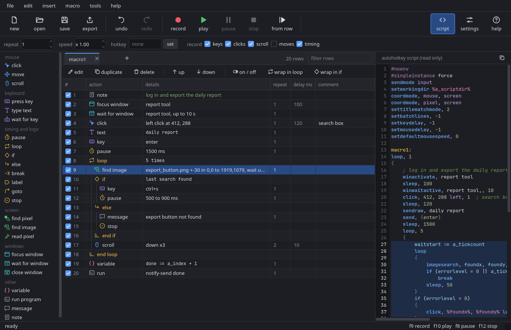
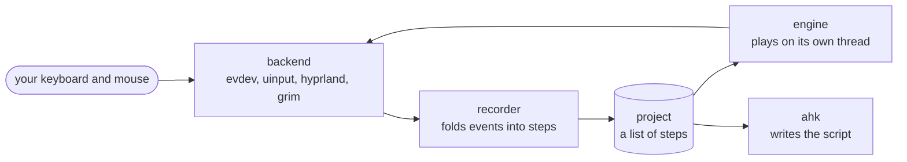

<div align="center">


# reprise macro creator

record what you do with your mouse and keyboard, edit it as a list of steps, and play it back.

[](https://github.com/ythundered/reprise-macro-creator/releases/latest)
[](https://github.com/ythundered/reprise-macro-creator/actions/workflows/tests.yml)
[](LICENSE)
[](#platforms)

[download](#download) &nbsp;|&nbsp; [using it](#using-it) &nbsp;|&nbsp; [how it works](#how-it-works) &nbsp;|&nbsp; [tests](#tests)

</div>



## what it does

- **record** the keyboard, mouse buttons, scrolling, cursor paths and real timing from any window
- **edit** steps in a table: drag to reorder, untick to skip, wrap rows in a loop or an if
- **react to the screen** with pixel search, image search and window checks
- **add logic** with variables, labels, and autohotkey-style expressions
- **export** any project as an autohotkey v1 script, with a live preview next to the list

> [!NOTE]
> this is a first release. the test suite runs against a fake input backend, so real playback has had far less mileage than the rest. exported scripts follow autohotkey v1 syntax but have not been run through autohotkey itself yet. bug reports are welcome.

## download

one file, nothing else to install. python, qt and everything else are inside it.

| system | file |
| :--- | :--- |
| windows 10 / 11 | [**reprise-macro-creator-windows-x64.exe**](https://github.com/ythundered/reprise-macro-creator/releases/latest/download/reprise-macro-creator-windows-x64.exe) |
| linux on hyprland | [**reprise-macro-creator-linux-x86_64**](https://github.com/ythundered/reprise-macro-creator/releases/latest/download/reprise-macro-creator-linux-x86_64) |

**windows:** double-click it. the exe isn't code signed, so windows may warn you the first time. choose more info, then run anyway.

**linux:** browsers drop the executable flag, so set it once and run it:

```sh
chmod +x reprise-macro-creator-linux-x86_64
./reprise-macro-creator-linux-x86_64
```

it adds itself to your app menu the first time it runs, and shows up as reprise macro creator after that. startup takes a second or two because it unpacks itself each time.

### platforms

| platform | status |
| :--- | :--- |
| linux on hyprland | the target platform |
| other linux desktops | not supported, cursor moves and window control go through hyprland |
| windows | starts and passes its backend tests on windows in ci, but hasn't had real use yet |

### linux permissions

the app reads `/dev/input` for hotkeys and recording, and writes to `/dev/uinput` for playback. if it can't, it offers to fix that on first launch and asks for your password once. no relog needed.

> [!CAUTION]
> this lets any program you run read your keyboard and mouse while you're logged in, not just this one. only do it on a computer you trust.

<details>
<summary><b>doing it by hand</b></summary>

<br>

```sh
sudo tee /etc/udev/rules.d/70-reprise-macro-creator.rules <<'RULES'
SUBSYSTEM=="input", KERNEL=="event*", TAG+="uaccess"
KERNEL=="uinput", SUBSYSTEM=="misc", TAG+="uaccess", OPTIONS+="static_node=uinput"
RULES
sudo udevadm control --reload-rules
sudo udevadm trigger --subsystem-match=input --subsystem-match=misc
```

delete that file to undo it.

</details>

<details>
<summary><b>running from source</b></summary>

<br>

you need python 3.10 or newer. on linux you also need `grim` and `slurp`.

```sh
git clone https://github.com/ythundered/reprise-macro-creator
cd reprise-macro-creator
pip install -r requirements.txt
python3 -m reprise
```

on linux, `./install.sh` adds a `reprise` command and an app menu entry.

to build the single-file version yourself: `pip install pyinstaller`, then `pyinstaller packaging/reprise.spec`. the builds on the releases page come from [`release.yml`](.github/workflows/release.yml).

</details>

## using it

1. press record, do the task in any window, then press <kbd>f9</kbd> again.
2. double-click a row to change it, drag rows to reorder them, untick a row to skip it.
3. press play. <kbd>f12</kbd> stops it at any time.

you can also build macros by hand from the commands on the left. <kbd>f1</kbd> opens the full guide, and file > open example loads a small macro that only shows messages.

<details>
<summary><b>hotkeys</b></summary>

<br>

these four work from any window and can be changed in settings:

| key | what it does |
| :--- | :--- |
| <kbd>f9</kbd> | record / stop recording |
| <kbd>f10</kbd> | play the current macro |
| <kbd>f8</kbd> | pause / resume |
| <kbd>f12</kbd> | stop |

these work in the list:

| key | what it does |
| :--- | :--- |
| <kbd>enter</kbd> | edit the selected row |
| <kbd>space</kbd> | turn the selected rows on or off |
| <kbd>delete</kbd> | delete the selected rows |
| <kbd>ctrl</kbd> + <kbd>d</kbd> | duplicate |
| <kbd>ctrl</kbd> + <kbd>up</kbd> / <kbd>down</kbd> | move rows |
| <kbd>ctrl</kbd> + <kbd>l</kbd> / <kbd>i</kbd> | wrap the selection in a loop / an if |
| <kbd>ctrl</kbd> + <kbd>z</kbd> / <kbd>y</kbd> | undo / redo |
| <kbd>ctrl</kbd> + <kbd>f5</kbd> | play from the selected row |
| <kbd>ctrl</kbd> + <kbd>shift</kbd> + <kbd>f5</kbd> | play only the selected rows |

</details>

<details>
<summary><b>expressions</b></summary>

<br>

expressions follow autohotkey syntax. you can use them in if, loop and variable steps, and in x / y fields.

```autohotkey
count < 10 && foundx > 0
name = "abc"
"hello " . name
foundx + 10
```

inside text, write `%name%` to insert a variable.

| built-in | meaning |
| :--- | :--- |
| `a_index` | the current loop run |
| `foundx`, `foundy` | where the last search hit |
| `errorlevel` | 0 after a success, 1 after a failure |
| `a_tickcount`, `a_now` | the time |
| `a_screenwidth`, `a_screenheight` | the screen size |

functions: `abs` `round` `floor` `ceil` `mod` `min` `max` `sqrt` `strlen` `substr` `instr` `strreplace` `getkeystate` `winactive` `winexist`

</details>

## how it works



**projects.** a project is a json file (`.reprise`) holding a list of macros, and each macro is a list of steps. [`model.py`](reprise/model.py) defines every step type in one table: its defaults, the fields its form shows, and the one-line hint. the forms in [`dialogs.py`](reprise/dialogs.py) are built from that table, so adding a step type mostly means adding an entry. `model.analyze()` matches up loops, ifs and labels, and that one result drives the indentation, the red error rows and the playback jumps.

**input.** [`backend.py`](reprise/backend.py) picks a platform backend, and everything else talks to the same small interface. on linux, [`backend_linux.py`](reprise/backend_linux.py) reads key and mouse events directly from evdev, injects them through a virtual uinput device, moves the cursor and finds windows over the hyprland socket, and reads the screen with grim. it skips its own virtual device when listening, so playback is never mistaken for you typing.

**recording.** [`recorder.py`](reprise/recorder.py) collects raw events and then folds them into readable steps. a key down and up becomes one press, typed letters become one text step (even when fast typing overlaps the keys), and two quick clicks become a double click. the time between events becomes each step's delay.

**playback.** [`engine.py`](reprise/engine.py) runs a small interpreter on its own thread, so the window stays responsive. it has a program counter, a stack for loops, and checks for stop or pause before every step and during waits. it remembers which keys and buttons it is holding and lets go of them however the macro ends. expressions ([`expr.py`](reprise/expr.py)) are parsed to a syntax tree and walked by hand. they are never passed to python's `eval`.

**screen search.** pixel and image search use numpy on a captured region. image search tests the rarest colors in the picture first, so most wrong positions are thrown out after a single pixel.

**export.** [`ahk.py`](reprise/ahk.py) turns a project into a script and records which script lines came from which row. that map is how the script pane highlights your selection and the running row. the script is written in lowercase, which autohotkey accepts.

**the ui** lives in [`window.py`](reprise/window.py), with the table model and script view in [`widgets.py`](reprise/widgets.py), and the colors and icons in [`theme.py`](reprise/theme.py) and [`icons.py`](reprise/icons.py).

## good to know

> [!WARNING]
> macros run with your permissions, and a run step can start any program. don't play project files from people you don't trust.

> [!IMPORTANT]
> if you type a password while recording, it ends up in the macro. your unsaved session is stored in `~/.config/reprise`, readable only by you, but project files you save are plain text.

- the app temporarily binds its hotkeys in hyprland so they don't reach other apps, and removes them on exit. after a hard kill, `hyprctl reload` clears them.
- exported scripts need autohotkey v1, not v2.

## tests

```sh
python3 -m unittest
```

the tests use a fake backend and an offscreen window, so they never touch your real mouse or keyboard.

## license

[mit](LICENSE). not affiliated with autohotkey or pulover's macro creator. it depends on pyside6 (lgpl), numpy, pillow and python-evdev, which keep their own licenses.
